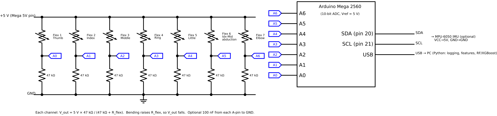

# Flex-sensor sign-language glove: real hardware, data and machine learning

Firmware, data-collection protocol, recorded data, glove quality checks and machine-learning
analysis for a seven-flex-sensor glove that recognises the 26 ASL fingerspelling letters
(5 finger sensors + 1 index–middle abduction sensor + 1 elbow sensor; IMU input supported).

**Author:** Dr. Othman Alfahd, Department of Biomedical Technology, Prince Sultan Military
College of Health Sciences, Saudi Arabia (othman@psmchs.edu.sa)

Accompanies the IEEE PIC 2026 paper *"Enhancing Sign Language Communication Using Machine
Learning and Smart Circuits: A Real-Hardware Evaluation of a Seven-Sensor Flex Glove"*.

[](https://doi.org/10.5281/zenodo.24146212)

## Main results (real glove, all 26 letters)

| Evaluation | Accuracy |
|---|---|
| Within session (leave-one-round-out), Random Forest, raw readings | 89.4% |
| Across sessions after re-donning the glove (leave-one-session-out) | 85.1% |
| Unseen user T1 (trained on S1 only) | 90.8% (95% CI 84.6–94.6%) |
| Effect of the two added sensors (cross-session) | 74.7% → 85.1% |
| End-to-end latency | about 420 ms |

On sound hardware, rest-pose calibration and statistical features did not improve accuracy;
wiring faults were the dominant real-world problem and are caught by `python/quality.py`.
Run `python python/paper_results.py` to regenerate every table and figure of the paper from `data/`.

## Repository layout
```
arduino/flex_glove_logger/   Arduino Mega firmware (7 flex sensors + optional MPU-6050, 50 Hz)
python/collect_data.py       guided data collection -> data/<subject>_sess<n>.csv
python/features.py           calibration, smoothing, 40 flex (30 with 5 sensors) + 6 IMU features
python/analyze.py            paper tables: drift, 2x2 ablation, IMU, learning curve, added-sensor
                             effect, per-trial table, latency
python/ml_benchmark.py       23 ML / deep models, statistical tests, tuning, explainability
python/train_test.py         final test: train on TRAIN participants, test on new TEST participants
python/live_demo.py          real-time translation + latency measurement
python/sensor_characterisation.py  bench test of one sensor: hysteresis, repeatability, noise, R range
python/bend_test.py          guided wiring check: straight/bent value, crosstalk, best resistor per channel
python/quality.py            glove check after every round (open/short/loose wire, broken or flat sensor)
python/paper_results.py      reproduces Tables II–V and Figs. 3–6 of the paper -> results/paper/
figures/                     circuit schematic (and script to redraw it)
data/                        all recorded sessions, sensitivity and pilot data, sensor tests (data/README.md)
results/paper/               outputs of paper_results.py
```

## 1. Hardware
| Item | Qty | Note |
|---|---|---|
| Arduino Mega 2560 | 1 | Uno: A4/A5 are also I2C, so no IMU with 5 sensors. Pico: only 3 ADC inputs |
| Flex sensors | 7 | A0–A4: thumb → little (along each finger); A5: index–middle abduction; A6: elbow |
| Fixed resistors | 7 | ≈ √(R_flat·R_bent); typically 47 kΩ (2.2" sensor) or 22 kΩ (4.5") |
| 100 nF capacitors | 7 | optional, A-pin to GND |
| MPU-6050 (GY-521) | 1 | optional; VCC→5V, GND→GND, SDA→20, SCL→21 |

Why the two extra sensors: flexion sensors along the fingers cannot see finger *spreading*
(U = index and middle together, V = apart), nor arm posture (G, H, P, Q, J, Z differ mainly by
how the hand is held).
- **Abduction sensor (A5):** lay it across the gap between the proximal phalanges of the
  index and middle fingers on the back of the hand, glued/sewn at both ends; spreading the
  fingers bends it.
- **Elbow sensor (A6):** along the back of the elbow inside a sleeve; it measures elbow flexion.

```
5V ──[FLEX]──●── A0..A6        V_out = 5 V · R / (R + R_flex)
             │
            [R]   (+ optional 100 nF to GND)
             │
            GND
```


Test: upload the sketch, open the Serial Monitor at 115200 baud and bend each finger;
its column (f0..f6) should change by roughly 100–300 counts.
Or, with the Serial Monitor closed: `python bend_test.py --port COM3` (guided, saves a CSV and
prints straight/bent ADC, crosstalk and the best fixed resistor for every channel).

## 2. Install
```
pip install -r requirements.txt
```

## 3. Characterise the sensors (bench test, before mounting)
For each sensor type (finger 2.2" and, if different, the abduction / elbow sensor):
```
cd python
python sensor_characterisation.py --port COM5 --channel 1 --sensor-name index --r-fixed 47000
```
Tape the sensor base next to a protractor. For 3 cycles the script asks for 0 → 30 → 60 → 90°
(loading) and 90 → 60 → 30 → 0° (unloading); bend, hold still, press Enter (2 s recorded per step).
It writes `data/characterisation/<name>_ch<k>.csv`, and to `results/characterisation/` a summary
(span, sensitivity in counts/°, **hysteresis** in counts, % of span and degrees, repeatability,
noise, R_flex at 0° and 90° computed from the divider, suggested fixed resistor) and the figure
`fig_hysteresis_<name>.png`.

Also record for the paper: supply current of the whole system (USB power meter or multimeter in
series, with and without the IMU) and the multimeter values of R_flat / R_bent.

## 4. Collect data
```
cd python
python collect_data.py --port COM5 --subject S1 --session 1 --rounds 10
```

**Participant protocol (held-out test).**

| Group | Participants | Sessions × rounds | Trials per letter | Command options |
|---|---|---|---|---|
| Training | 5 (S1–S5) | 3 × 10 (glove re-donned between sessions) | 30 per person, 150 in total | `--split train` |
| Test | 3 new people (T1–T3) | 1 × 5 | 5 per person, 15 in total | `--split test --rounds 5` |

Letters are presented in a new random order in every round for both groups, so no letter is
always preceded by the same letter or always recorded at the same point of a round
(`--order alphabetical` exists but is not used in the study).
```
python collect_data.py --port COM5 --subject S1 --session 1 --split train
python collect_data.py --port COM5 --subject T1 --session 1 --split test --rounds 5
```
If a glove fault interrupts a session, repair it and continue the same session with `--resume`;
exclude the faulty round with `python quality.py ../data/S1_sess2.csv --discard 5 --reason "A2 wire open"`.
After every round an automatic glove check is printed (open wire, touching wires, loose joint,
broken or non-responding sensor); `python quality.py ../data/S1_sess2.csv` re-checks a saved session.
The program refuses to record a participant code in both groups. `analyze.py` and
`ml_benchmark.py` use only the training participants (model development);
the test participants are used once, by `train_test.py`.
Each letter: 3 s to form it, then 3 s recorded hold. With `--manual` (recommended for participants
new to ASL) the letter and a short hand-shape hint are shown and the program waits for Enter before
the 3 s recording, so every participant forms the letter at their own pace. All 26 ASL letters in random order each round (J and Z are traced during a 5 s hold), with a
4 s open-hand REST recording before each round (used for calibration). After every round the
trials are listed and the operator can correct the letter actually signed (`7=V`) or discard a
bad trial (`7=x`). Corrections are stored in `data/<subject>_sess<n>_trials.csv`
(`correct_letter`, `valid`, `note`), which can also be edited later; the analysis always uses it.
Take the glove off and on again between sessions. Recommended: ≥ 2–3 participants × 3 sessions × 10 rounds.

Note: every trial is classified from one 400 ms window (20 samples) taken from the middle of the hold.
For the dynamic letters J and Z this window covers only part of the trace, so their accuracy is a
known limitation of the static-window design.

## 5. Analyse
```
python analyze.py                                        # paper tables (drift, ablation, IMU, learning curve, latency)
python ml_benchmark.py --tune
python train_test.py                                     # final held-out-participant test
```
`train_test.py` (default six models: Logistic Regression, KNN, RBF SVM, Random Forest, XGBoost,
MLP; change with `--models`, list with `--list`) first runs leave-one-participant-out CV on the
training participants and selects a model there, then fits every model once on all training data
and evaluates it once on the test participants: accuracy, balanced accuracy, macro-F1, κ, top-3,
per participant, per letter, McNemar, compute latency, confusion matrix (`results_test/`).
Data are read from `data/` and results written to `results/` and `results_ml/` at the repository root (override with `--data` / `--out`).
All evaluations use **leave-one-session-out** cross-validation with identical real labels.
`analyze.py` also writes `tableF_sensor_configuration.csv` (5 fingers vs + abduction vs + elbow
vs all 7, overall and on U/V/R and G/H/J/P/Q/Z) and `trial_table.csv` (one row per trial: correct
letter, raw and calibrated value of each sensor, prediction of each model, 1 = correct).
`ml_benchmark.py` writes `predictions_per_trial.csv` (correct letter + prediction of all 23 models).

`ml_benchmark.py` covers:
| Family | Models |
|---|---|
| Linear | Logistic Regression, Ridge, LDA |
| Probabilistic | Gaussian Naive Bayes, QDA (PCA + regularised) |
| Instance-based | KNN |
| Kernel | Linear SVM, RBF SVM |
| Trees / bagging | Decision Tree, Bagging, Random Forest, Extra Trees |
| Boosting | AdaBoost, Histogram Gradient Boosting, XGBoost, LightGBM |
| Neural | MLP |
| Ensembles | Soft voting, Stacking |
| Deep temporal (raw 20-step windows, needs torch) | 1D-CNN, BiLSTM, BiGRU, CNN-LSTM |
| Unsupervised (interpretive) | KMeans, GMM, Agglomerative, Spectral + PCA / t-SNE |

Outputs: accuracy, balanced accuracy, macro P/R/F1, Cohen's κ, top-3 accuracy, fold mean ± sd,
training / inference time; Friedman and Holm-corrected McNemar tests; nested hyper-parameter
tuning (`--tune`); permutation importance and feature-group ablation; confusion-group analysis;
user-independent (leave-one-subject-out) evaluation; 300-dpi figures.

## 6. Live demo
```
python live_demo.py --port COM5
```

## Citation
See `CITATION.cff`. License: MIT.

## How to cite

Alfahd, O. (2026). *Seven-sensor flex glove for ASL fingerspelling: firmware, real recorded data and machine-learning analysis* (v1.0.0) [Data set and software]. Zenodo. https://doi.org/10.5281/zenodo.24146212
